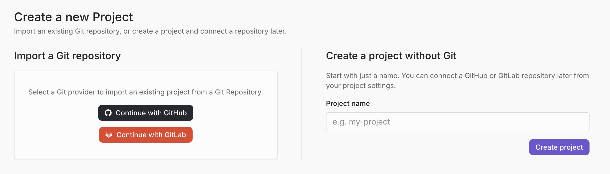

# Account management

When you sign up for Argos, you create an account that manages your projects and subscriptions. You can sign up with **Google**, **GitHub**, or **GitLab** — see [Pricing plans](../billing-and-subscription/pricing-plans.md) for what each plan includes.

### Sign up with a Git provider

Argos supports [GitHub](../integrations/github-integration.md) and [GitLab](../integrations/gitlab-integration.md) as Git providers. When you sign up with one, you authorize Argos to access it, and that connection becomes your default login method. After signing up, you can manage login methods in your **Personal Settings**.

### Login methods and connections

To manage login connections:

1. Select your profile picture in the top-right corner of the dashboard.
2. Choose **Settings**.
3. Open the **Authentication** section.

#### Logging in with a passkey

A passkey lets you sign in with your fingerprint, face, screen lock, or a hardware security key instead of a code or a Git provider. You can register several and use any of them.

For setup and login instructions, see [Passkeys](passkeys.md).

#### Logging in with SAML Single Sign-On (SSO)

SAML SSO allows team members to log in with their organization’s identity provider.

For setup and login instructions, see [SAML Single Sign-On](saml-single-sign-on.md).

### Creating a project

You can create a project in two ways from the **New Project** page — import an existing Git repository, or start with just a name and connect a repository later.



Choose **Import a Git repository** and select a Git provider (GitHub or GitLab) to import a repository. Argos links the project to that repository, which enables [pull request comments](../review-workflow/pull-request-comments.md) and status checks.



Choose **Create a project without Git**, enter a **Project name**, and select **Create project**.

A project without a connected repository still receives builds through the [Argos CLI](../../sdks-reference/argos-command-line-interface-cli.md) using its project token. Features that depend on a repository — such as pull request comments — become available once you link one.



#### Connect a repository later

To link a repository to a project you created without Git:

1. Open the project's **Settings**.
2. Go to the **Connected Git Repository** section.
3. Select a Git provider and choose the repository to connect.

You can disconnect or change the repository from the same section at any time.

### Delete a project

Only project admins can delete a project. To keep it under another account instead, [transfer it](../billing-and-subscription/how-to-subscribe.md#transfer-your-projects).

1. Open the project's **Settings**, in the **General** section.
2. On the **Delete Project** card, select **Delete**.
3. Type the project's full name (`account/project`), then `delete my project`, and select **Delete**.

Argos warns that this can't be undone. Once the project is deleted, uploads with its project token fail and Argos stops updating its commit statuses. If the Argos check is a required status check in your Git provider, remove it there, or open pull requests keep waiting for it.

### Uninstall the GitHub App

You uninstall the Argos GitHub App from GitHub, not from Argos:

* **Personal account:** in GitHub's **Settings → Applications → Installed GitHub Apps**, select **Configure** next to Argos, then **Uninstall**.
* **Organization:** in the organization's **Settings → GitHub Apps** (under "Third-party Access"), select **Configure** next to Argos, then **Uninstall**.

When GitHub notifies Argos, Argos disconnects each repository it can no longer access from its Argos projects. Their builds no longer get commit statuses or pull request comments, and uploads that use [OIDC or tokenless authentication](../integrations/github-actions-authentication.md) fail. Uploads with a project token are still accepted.

Removing a repository from the app's **Repository access** has the same effect on that repository. To undo it, [install the app](../integrations/github-integration.md#install-the-argos-github-app) again and reconnect the repository from the project's settings.

### Teams

Teams let you collaborate on projects and share resources.

#### Creating a team

1. Select the **scope selector** in the top-left of the navbar.
2. Choose **Create new team**.
3. Enter a team name.
4. By default, new teams start on the **Pro plan**. To switch plans, [contact us](https://argos-ci.com/contact).

Team settings and members can be managed from the team’s settings page.

#### Free Pro trial

Your first team automatically starts with a **14-day free trial of Argos Pro**.

The trial includes unlimited users and **35,000 free screenshots**.

#### Team membership

Owners can invite new members using an invitation link found in **Team Settings**.

See [Roles and permissions](team-members-and-roles.md#owner-role) for details.

**Inviting teammates**

1. From the dashboard, select your team from the scope selector.
2. Open the **Settings** tab and go to the **Members** section.
3. Select **Invite Link** and copy the generated link.
4. Share the link with anyone you want to join the team.


Public repositories on Argos are accessible to everyone.


#### Leaving a team

You cannot leave a team if you are the **last owner** or the **last member**.

To leave a team:

1. If necessary, assign another owner first.
2. Go to your team's **Settings** tab and go to the **Members** section.
3. Scroll to **Leave Team** and select **Leave Team**.
4. Confirm the action.
5. If you are the last member, [delete the team](account-management.md#deleting-a-team) instead.

#### Deleting a team

Only team [owners](team-members-and-roles.md#owner-role) can delete a team. Deleting a team also deletes its projects, so you don't need to remove them first. To keep a project, [transfer it](../billing-and-subscription/how-to-subscribe.md#transfer-your-projects) to another account before you delete the team.

1. If the team has an active subscription, cancel it first in **Settings → Billing → Manage subscription**. The **Delete** button stays disabled until you do.
2. Open the team's **Settings** tab, in the **General** section.
3. On the **Delete Team** card, select **Delete**.
4. Type the team slug, then `delete my team`, and select **Delete**.

### Managing emails

To access email settings:

1. Select your avatar in the top-right corner.
2. Choose **Settings**.
3. Scroll to the **Emails** section.
4. From here, you can [add](account-management.md#adding-a-new-email-address), [remove](account-management.md#removing-an-email-address), or [change](account-management.md#changing-your-primary-email-address) your primary email.

### Adding a new email address

1. In the **Emails** section, select **Add Another**.
2. Verify the new address using the link sent to your inbox.
3. Once verified, any email address on your account can be used to log in.

### Changing your primary email address

Your primary email is used for Argos notifications.

To change it:

- Add and verify a new email.
- Open the dot menu next to the address and choose **Set as Primary**.

### Removing an email address

To remove an address, use the **Delete** option in the dot menu.

> Note: You must set a new primary email before removing the current one.

### Resolving "Account already attached" issues

If you see the error message:

> **Your&#x20;**_**GitHub|GitLab|Google**_**&#x20;account is already linked to another Argos account**

it means the provider account you are trying to connect is already associated with a different Argos account.

#### Steps to fix




### Log out of Argos

Select your avatar in the top-right corner, then select **Log out**.




### Log back in with your provider

From the login page, choose **Continue with&#x20;**_**GitHub|GitLab|Google**_.

This will sign you into the Argos account that currently owns your provider link.




### Disconnect or delete the account

Once logged in, select your avatar in the top-right corner, choose **Settings**.

Select **Authentication** from the sidebar.

Find the _GitHub|GitLab|Google_ connection, select the vertical ellipsis (⋮), and select **Disconnect**.

Alternatively, if the account is no longer needed, you can delete it entirely from **Account Settings → General**.




### Log out again

Return to the login page.




### Reconnect with the right account

Log back in with the account you want to use.

From the **Authentication** section, link your provider account.



After completing these steps, your provider account will be linked to the correct Argos account.
