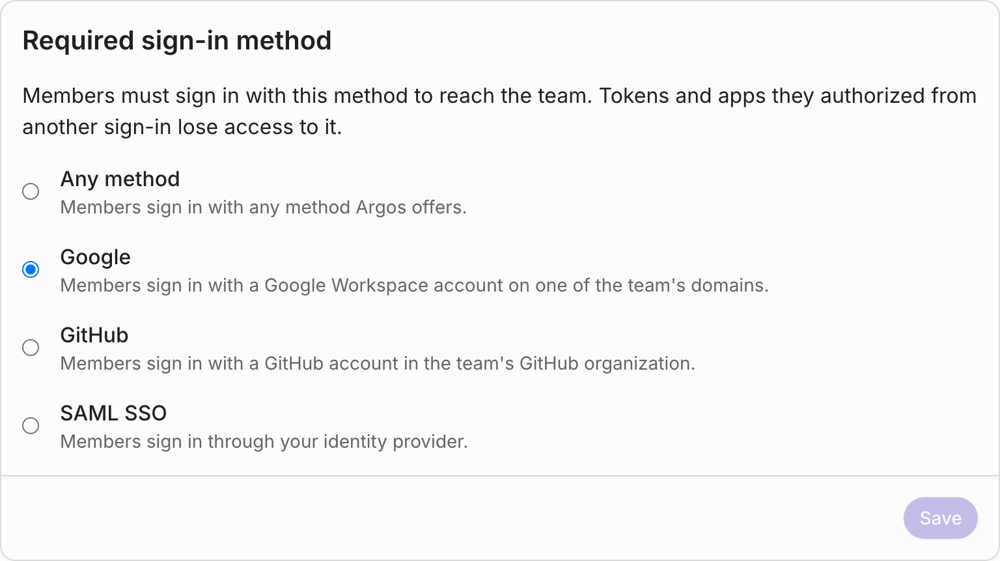
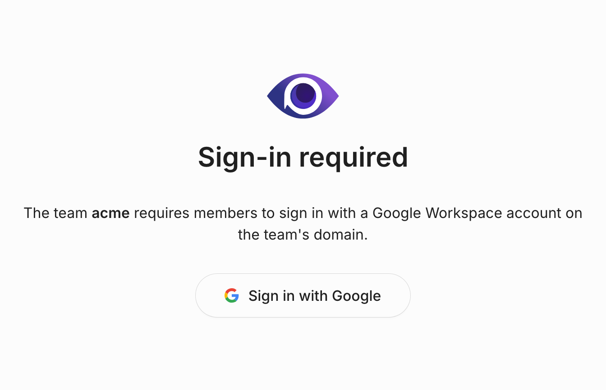

# Required sign-in method

By default, members reach your team however they signed in to Argos: an email code, a passkey, Google, GitHub, GitLab, or SAML SSO. A required sign-in method makes them sign in with Google, GitHub, or SAML SSO, using an account your company controls. Once someone leaves your Google Workspace, your GitHub organization, or your identity provider, they can no longer sign in to reach the team.


Only team members with the [owner role](team-members-and-roles.md#owner-role) can change the required sign-in method. The requirement applies to every member, owners included.


### Methods you can require

* **Google**: members sign in with a Google Workspace account on one of the team's domains. Personal Google accounts, such as `@gmail.com` addresses, don't qualify. The team needs at least one domain in **Team domains**.
* **GitHub**: members sign in with a GitHub account in the organization linked through [GitHub single sign-on](github-single-sign-on.md). The team needs GitHub SSO.
* **SAML SSO**: members sign in through your identity provider. The team needs [SAML SSO](saml-single-sign-on.md) configured and enabled, on a plan that includes it.

Until the team has what a method needs, that method is disabled in the settings, with what to set up.


**Team domains** are in **Team Settings → Authentication**. A domain also lets anyone with a verified email address on it join the team, at the team's default role. To add one, you need a verified email address on it yourself.


### Require a sign-in method



Sign in with the method you want to require, using an account that meets it. Argos only lets you require the method you are signed in with, so you can't lock yourself out.



Go to **Team Settings → Authentication** and find **Required sign-in method**.



Select the method, then **Save**.



If you are signed in another way, the card shows a **Sign in with** button instead. It signs you in with that method and brings you back to the settings.

To stop requiring a method, select **Any method**, then **Save**.

### What members see

A member signed in another way who opens the team sees **Sign-in required**, with a button to sign in with the team's method. Their personal account and their other teams stay available.

Signing in with the required method opens a new session. A SAML SSO sign-in counts only for the team whose identity provider you signed in through.

### Personal access tokens and applications

A personal access token, or an application you authorize such as the Argos CLI or an MCP client, keeps the sign-in method of the session you created or authorized it from. When that method is not the one a team requires, the token or application loses access to that team and keeps access to your other accounts.

To restore its access, sign in with the required method, then create a new token or authorize the application again. For the CLI, run `argos login`.

[Project tokens](project-tokens.md) don't belong to a user, so CI uploads keep working.

### When the team loses the setup

A requirement only applies while the team has what members need to meet it. Otherwise it would lock every member out, owners included.

* **Google**: when you remove the team's last domain, members sign in with any method until you add one.
* **GitHub**: when you disable GitHub SSO, members sign in with any method until you enable it again.
* **SAML SSO**: when you turn SAML SSO off, members sign in with any method until you turn it back on. Removing the SAML configuration, or disabling the SAML SSO add-on, sets the requirement back to **Any method**.

The **Required sign-in method** card shows a notice while the requirement doesn't apply.

### Troubleshooting

"You are not signed in with Google" when saving

Argos only lets you require the method you are signed in with. Select **Sign in with Google** in the card, then save again. The same goes for GitHub and SAML SSO.

"Your Google account is not a Google Workspace account on one of the team's domains"

The Google account linked to your Argos account is a personal account, or a Workspace account on a domain the team doesn't have. Add the domain to **Team domains** if it is missing.

If your Argos account is linked to another Google account, open your personal **Settings → Authentication**, disconnect Google, then connect your work account and sign in with it.

"Your GitHub account is not in the team's GitHub organization"

The GitHub account linked to your Argos account is not a member of the organization linked through GitHub SSO. Ask an owner of the organization to add it.

If your Argos account is linked to another GitHub account, open your personal **Settings → Authentication**, disconnect GitHub, then connect the account that is in the organization and sign in with it.

A token or the CLI is refused with "requires sign-in with"

The token, or the application's authorization, was issued from a session that doesn't meet the team's requirement. Sign in with the required method, then create a new token, or run `argos login` again.

