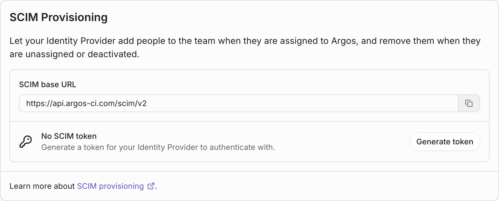
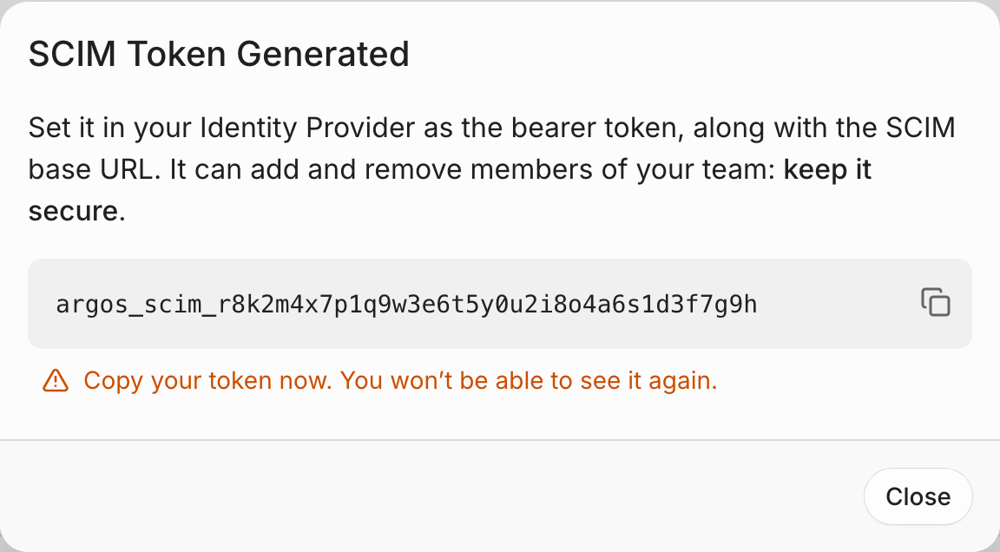
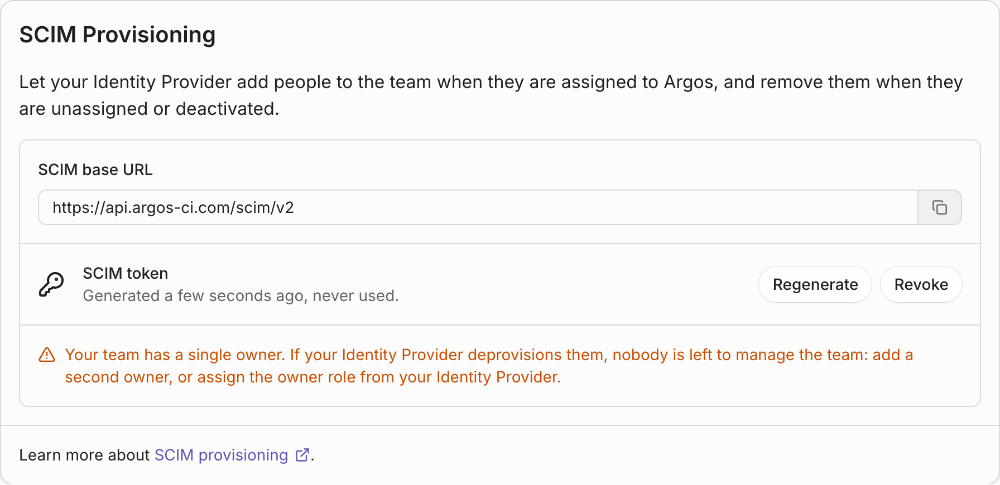
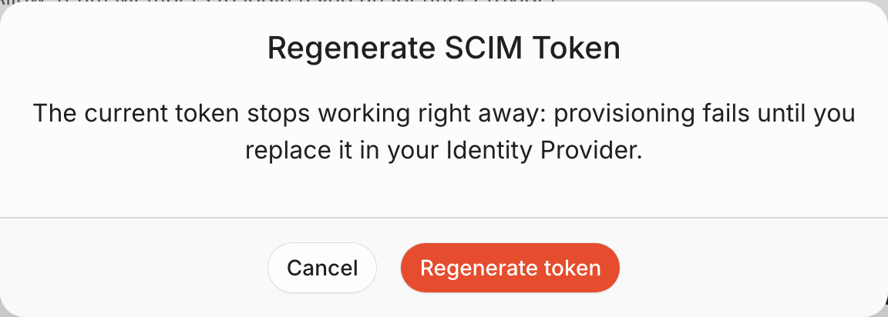
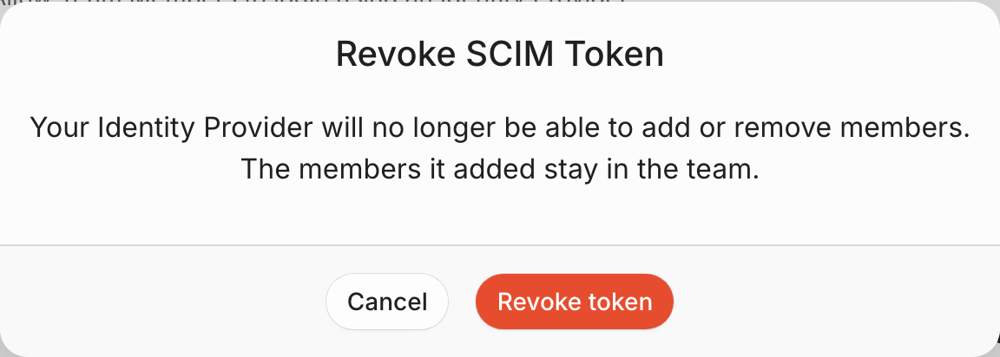

# SCIM provisioning


SCIM provisioning is part of [SAML SSO](saml-single-sign-on.md): it is included in the [Enterprise](../billing-and-subscription/pricing-plans.md#enterprise-plan) plan, and available with the [SAML SSO add-on](saml-single-sign-on.md#enabling-the-add-on).

Only team members with the [owner role](team-members-and-roles.md#owner-role) can set it up.


SCIM (System for Cross-domain Identity Management) lets your identity provider manage your Argos team for you. When someone is assigned to Argos in Okta, Microsoft Entra ID or any SCIM 2.0 identity provider, they become a member of your team. When they are unassigned or deactivated, they lose access right away — no one has to remember to remove them from Argos.

Without SCIM, [SAML SSO](saml-single-sign-on.md) adds people on their first sign-in and offboarding is manual. With SCIM:

- **Onboarding is automatic** — people are members before they ever sign in.
- **Offboarding is immediate** — deactivating someone in your identity provider removes them from the team.
- **Roles come from your identity provider** — map who is an owner, a member or a contributor.
- **Your identity provider stays the source of truth** — assignments, deactivations and role changes reach Argos on every sync.



## Set up SCIM provisioning

### Before you start

- Your team has access to SAML SSO, through the Enterprise plan or the add-on.
- You are an [owner](team-members-and-roles.md#owner-role) of the team.
- We recommend configuring [SAML SSO](saml-single-sign-on.md) in the same identity provider app first, so the people SCIM provisions can sign in with it.
- We recommend having at least two owners, or [mapping roles](#map-roles-from-your-identity-provider) — see [When the last owner leaves](#when-the-last-owner-leaves).

### Generate the SCIM token



### Open the SCIM settings

From the dashboard, select your team, open the **Settings** tab, then go to **Authentication**. Scroll to **SCIM Provisioning**.



### Copy the SCIM base URL

Your identity provider asks for it as the **SCIM connector base URL** (Okta) or the **Tenant URL** (Microsoft Entra ID):

```
https://api.argos-ci.com/scim/v2
```



### Generate a token

Click **Generate token**, then **Generate token** again to confirm. Copy the token right away: it starts with `argos_scim_`, and Argos only shows it once.



Treat it like a password: anyone holding it can add and remove members of your team.



### Hand them to your identity provider

Give your identity provider the base URL and the token, as described below. The token is sent as a bearer token in the `Authorization` header.



Once the token exists, the card shows when it was generated and when your identity provider last used it.



### Configure your identity provider



Enable SCIM on the Argos app integration you use for SAML:

1. In the Okta Admin Console, open **Applications -> Applications** and select your Argos app.
2. On the **General** tab, in **App Settings**, click **Edit**, set **Provisioning** to **SCIM**, and save.
3. Open the new **Provisioning** tab, then **Integration**, and click **Edit**:
   - **SCIM connector base URL**: `https://api.argos-ci.com/scim/v2`
   - **Unique identifier field for users**: `userName`
   - **Supported provisioning actions**: **Import New Users and Profile Updates**, **Push New Users** and **Push Profile Updates**. Leave the group actions off: Argos does not support group push.
   - **Authentication Mode**: **HTTP Header**, and paste the SCIM token as the **Bearer** token.
4. Click **Test Connector Configuration**, then **Save**.
5. On **Provisioning -> To App**, click **Edit** and enable **Create Users**, **Update User Attributes** and **Deactivate Users**. Save.
6. On the **Assignments** tab, assign the people or groups who should be members of your Argos team.

Okta provisions assigned users right away, and pushes profile changes as they happen. Unassigning someone, or deactivating them in Okta, removes them from your Argos team.



Enable provisioning on the enterprise application you use for SAML:

1. In the Microsoft Entra admin center, open **Enterprise applications** and select your Argos application.
2. Open **Provisioning**, and start a new configuration (**Get started** or **New configuration**).
3. Set **Provisioning Mode** to **Automatic**, and fill in **Admin Credentials**:
   - **Tenant URL**: `https://api.argos-ci.com/scim/v2`
   - **Secret Token**: the SCIM token
4. Click **Test Connection**, then **Save**.
5. In **Mappings**, set **Provision Microsoft Entra ID Groups** to **No**: Argos does not support group provisioning. Keep **Provision Microsoft Entra ID Users** on. Its default mappings work as is:
   - `userPrincipalName` → `userName`
   - `mail` → `emails[type eq "work"].value`
   - `givenName`, `surname` and `displayName` → `name.givenName`, `name.familyName` and `displayName`
   - the `IsSoftDeleted` switch → `active`
6. In **Settings**, set **Scope** to **Sync only assigned users and groups**, and turn **Provisioning Status** **On**. Save.
7. In **Users and groups**, assign the people or groups who should be members of your Argos team.

Entra ID runs a provisioning cycle about every 40 minutes. To provision one person right away, for example to try your setup, use **Provision on demand**.

Unassigning someone, or disabling them in Entra ID, removes them from your Argos team. When a user is deleted in Entra ID, Argos also forgets them.



Argos works with any identity provider that speaks SCIM 2.0 (OneLogin, JumpCloud, Rippling, …). Configure a SCIM app with:

- **Base URL**: `https://api.argos-ci.com/scim/v2`
- **Authentication**: bearer token, with the SCIM token
- **Unique identifier**: `userName`
- **Operations**: create, update and deactivate users. Argos does not support groups.

The [reference](#reference) lists the endpoints and attributes Argos supports.



## What happens when…

### Someone is assigned to Argos

Your identity provider creates the user, and Argos makes them a member of your team at the team's default access role — **member**, unless you changed it in **Team Settings -> Members** — or at the role your identity provider [sends](#map-roles-from-your-identity-provider).

Argos links the user to an Argos account by email. It reads the primary email, then the work email, then the first one, and falls back to `userName` when it is an email address:

- **Someone with an Argos account** that holds the email as a **verified** address gets linked to it. They keep their account, their other teams and their sign-in methods.
- **Someone new to Argos** gets an account, created with the email already verified and the name from your identity provider. They receive a welcome email, and can sign in with SAML or with the email.
- **An unverified email** never links: anyone can add an unverified address to their account, so Argos creates a new account for the email's real owner, and the unverified address is released.
- **Someone already in your team**, invited or added before SCIM, gets linked too and keeps their role, unless your identity provider sends one.

A user created as inactive is recorded, but not added to the team until your identity provider activates them.

### Someone's profile changes

Changes to the name, email, `userName` or `externalId` are synced and shown back to your identity provider. They don't change the person's Argos account, which belongs to them: their Argos name and sign-in emails stay theirs to manage.

### Someone is unassigned or deactivated

They are removed from your team at once: they lose access to its projects and builds, and personal access tokens scoped to the team stop working for it. Their Argos account is kept, with their other teams.

Argos still knows the user, so your identity provider can reactivate them later.

### Someone is reactivated

They are added back to the team, at the team's default access role or at the role your identity provider sends. The role they had before being deactivated is not restored on its own.

### Someone is deleted in your identity provider

They are removed from the team, and Argos forgets the SCIM user. Their Argos account is kept. If they are assigned again later, they are provisioned like a new user and linked to their account again.

### When the last owner leaves

Deprovisioning always goes through, even for the last owner of a team: blocking it would let someone who left your company keep owner access. If other members remain, the team is left without an owner, and nobody can manage its settings, billing or SCIM token.

To prevent it:

- Keep **at least two owners**. The SCIM card warns you when your team has a single owner.
- Or [map roles](#map-roles-from-your-identity-provider), so your identity provider can make someone else an owner, even once the team has none.

Argos is notified when SCIM leaves a team without an owner. [Contact us](https://argos-ci.com/contact) if you need help assigning a new one.

A team always keeps at least one member: deactivating its only member fails, and your identity provider reports the error.

### You change a member in Argos

SCIM-provisioned members are best managed from your identity provider:

- **Changing a role in Argos** works, and the role stays until your identity provider sends a different one.
- **Removing a member in Argos** works too, but your identity provider still sees them as active. It adds them back only after it deactivates and reactivates them.

Members who joined another way — invites, a verified email domain, SAML sign-in — are untouched by SCIM until your identity provider provisions them.

### Someone deletes their Argos account

Argos removes the link between their account and your identity provider. If your identity provider provisions them again, it gets a new account.

### Your team loses SAML SSO

If the SAML SSO add-on is disabled or your plan no longer includes it, every SCIM request is refused until it is back. The token is kept and starts working again then; members stay in the team.

## Map roles from your identity provider

Your identity provider can set each member's [team role](team-members-and-roles.md#team-level-roles) through the standard SCIM `roles` attribute. Argos reads these values, in any case:

| Value         | Role                                                                   |
| ------------- | ---------------------------------------------------------------------- |
| `owner`       | [Owner](team-members-and-roles.md#owner-role)                          |
| `member`      | [Member](team-members-and-roles.md#member-role)                        |
| `contributor` | [Contributor](team-members-and-roles.md#contributor-role) (Enterprise) |



1. In **App registrations**, open your Argos application, then **App roles**, and create one app role per value: `owner`, `member` and `contributor`. Allow **Users/Groups** as member types.
2. In your enterprise application, under **Users and groups**, assign each user or group one of these roles.
3. In **Provisioning -> Mappings -> Provision Microsoft Entra ID Users**, click **Add New Mapping**:
   - **Mapping type**: **Expression**
   - **Expression**: `SingleAppRoleAssignment([appRoleAssignments])`
   - **Target attribute**: `roles[primary eq "True"].value`

   If the target attribute is missing from the list, add it under **Show advanced options -> Edit attribute list**.



1. In **Directory -> Profile Editor**, open the profile of your Argos app and click **Add Attribute**:
   - **Data type**: **string array**
   - **Variable name** and **External name**: `roles`
   - **External namespace**: `urn:ietf:params:scim:schemas:core:2.0:User`
2. Set the role when you assign a person or a group to the app, or map it from a user attribute in the profile mappings.



How roles apply:

- **Roles apply when a user is provisioned, reactivated, or gets a different role.** Without a role, a new member gets the team's default access role, and an existing member keeps theirs.
- **When several roles are sent**, the primary one wins, then the first one.
- **An unknown value** is ignored, as if no role were sent. A mapping mistake never blocks provisioning or deprovisioning.
- **The last owner is never demoted.** When a role would demote the team's only owner, the rest of the update goes through and the owner stays an owner. Make someone else an owner first; the demotion applies at the next role change.

## SCIM and SAML together

SCIM decides who is in your team; [SAML SSO](saml-single-sign-on.md) decides how they sign in. Used together:

- People get access before their first sign-in, instead of on it.
- SAML sign-in finds the account SCIM linked, by email. Map the same email in both, which the default Okta and Entra ID mappings do.
- Deactivating someone in your identity provider both stops their SAML sign-in and removes them from the team.
- [Enforcing SAML](saml-single-sign-on.md#enforcing-saml) still requires members to sign in with SAML to reach the team.

## Rotate or revoke the token

- **Regenerate** replaces the token. The current one stops working at once, and provisioning fails until you paste the new one into your identity provider.
- **Revoke** deletes the token: your identity provider can no longer add or remove members. Members it already provisioned stay in the team.





## Reference

### Endpoints

All endpoints live under `https://api.argos-ci.com/scim/v2`, and answer `application/scim+json`. Requests accept `application/scim+json` and `application/json` bodies.

| Endpoint                 | Methods                         | Authentication |
| ------------------------ | ------------------------------- | -------------- |
| `/Users`                 | `GET`, `POST`                   | SCIM token     |
| `/Users/{id}`            | `GET`, `PUT`, `PATCH`, `DELETE` | SCIM token     |
| `/ServiceProviderConfig` | `GET`                           | None           |
| `/ResourceTypes`         | `GET`                           | None           |
| `/Schemas`               | `GET`                           | None           |

Groups, bulk operations, sorting, ETags and password changes are not supported.

### User attributes

| Attribute                           | Notes                                                                                                      |
| ----------------------------------- | ---------------------------------------------------------------------------------------------------------- |
| `userName`                          | Required. Unique in your team, compared case-insensitively.                                                |
| `externalId`                        | Optional. Stored and returned as is.                                                                       |
| `name.givenName`, `name.familyName` | Optional.                                                                                                  |
| `displayName`                       | Optional. Names the Argos account when SCIM creates it.                                                    |
| `emails`                            | The primary email, else the `work` one, else the first, is used to link the Argos account.                 |
| `active`                            | Defaults to `true`. `false` removes the member from the team. `"True"` and `"False"` strings are accepted. |
| `roles`                             | Optional. See [Map roles](#map-roles-from-your-identity-provider).                                         |

Other attributes, such as phone numbers or the enterprise user extension, are accepted and ignored.

### Filtering and pagination

`GET /Users` supports a single `eq` filter on `userName`, `externalId`, `id` or `emails.value`:

```
GET /scim/v2/Users?filter=userName eq "jane@acme.com"
```

Results are paginated with `startIndex` (1-based) and `count` (100 at most).

### Updates

`PATCH` accepts `add`, `replace` and `remove` operations, with or without a `path`, including filtered paths such as `emails[type eq "work"].value` and `roles[primary eq "True"].value`. `PUT` replaces the user; when it omits `active`, the user keeps their current state.

### Limits

- **3,000 requests per team every 5 minutes.** Beyond that, Argos answers `429` and your identity provider retries later.
- Requests with an invalid token are limited per address, so a client guessing tokens is stopped quickly.

### Errors

Errors follow the SCIM error format, with a `detail` explaining the problem:

| Status | When                                                                                 |
| ------ | ------------------------------------------------------------------------------------ |
| `400`  | Invalid value, filter or patch — for example a user without a valid email.           |
| `401`  | Missing or invalid SCIM token.                                                       |
| `403`  | The team no longer has SAML SSO, or the request would remove the team's last member. |
| `404`  | The user does not exist in your team.                                                |
| `409`  | A user with the same `userName` or email already exists in your team.                |
| `429`  | Too many requests.                                                                   |

## Troubleshooting

<details>

<summary>Testing the connection fails with 401</summary>

The token is missing, mistyped or revoked, or it was regenerated since. Generate a new token in **Team Settings -> Authentication**, and paste it again in your identity provider.

</details>

<details>

<summary>Requests fail with 403 "SCIM provisioning is part of SAML SSO"</summary>

Your team no longer has access to SAML SSO. Enable the [SAML SSO add-on](saml-single-sign-on.md#enabling-the-add-on) or contact us about the Enterprise plan: the existing token works again as soon as access is back.

</details>

<details>

<summary>A user fails with "The user needs a valid email"</summary>

Argos links people by email. Map a valid email to `emails`, or use email addresses as `userName`.

</details>

<details>

<summary>A user fails with 409</summary>

Another SCIM user of your team has the same `userName`, or is linked to the same person through the same email. Check for duplicate identities in your identity provider.

</details>

<details>

<summary>A role is not applied</summary>

- Check the value is exactly `owner`, `member` or `contributor`: other values are ignored.
- Roles apply when they change: re-sending the same role does not overwrite a change made in Argos.
- The team's last owner is never demoted: make someone else an owner first.

</details>

<details>

<summary>Someone deactivated in the identity provider can still sign in to Argos</summary>

That is expected: SCIM removes them from your team, not from Argos. They keep their own account and their other teams, but can no longer reach yours.

</details>
