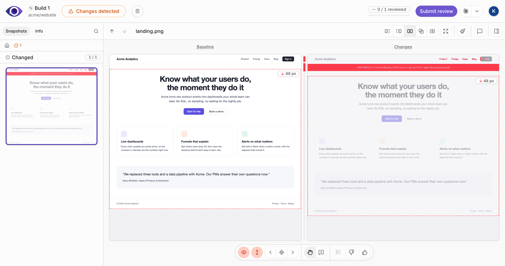

# How Argos detects visual differences

Argos uses **deterministic pixel diffing**, not AI-based visual comparison. Instead of compensating for flakiness, Argos focuses on eliminating it at the source. This keeps visual tests precise, explainable, and reliable over time.

### What Argos compares

Argos compares the snapshots produced by your tests against their counterparts in the [baseline build](baseline-build.md):

* **Screenshots** — rendered images of your pages, components, or stories.
* **ARIA snapshots** — text representations of your page's accessibility tree, captured by the [Playwright SDK](../../sdks-reference/playwright.md#aria-snapshots), that catch regressions invisible in pixels.
* **Text files** — any [non-image file](../how-to-guides/visual-coverage/compare-non-image-files.md) you upload, such as JSON or Markdown, diffed as text.

For each pair, the question Argos answers is intentionally simple: did it change, or not? No interpretation, no probability, no guesswork.

### The diff algorithm

Argos compares images with [**iris**](https://github.com/argos-ci/iris), its open-source diff engine. iris reproduces the pixel comparison of the [odiff](https://github.com/dmtrKovalenko/odiff) library by Dmitriy Kovalenko, which Argos used before it, in a single pass over each image. The full diff implementation is also open source — you can [inspect it here](https://github.com/argos-ci/argos/blob/main/apps/backend/src/screenshot-diff/diff/image/index.ts).

Each image comparison runs in three stages:

1. **Size alignment**: When the two images have different sizes, Argos places both at the top-left corner of a canvas as wide as the wider image and as tall as the taller one. The area only one of them covers shows up as changed. Images are never scaled.
2. **Two sensitivities**: iris evaluates two sensitivities in the same pass, with anti-aliasing detection on, so pixels that only differ by anti-aliasing are not counted.
   * The **tolerant** one ignores small color differences (color threshold `0.15`). Its result is discarded when fewer than 20 pixels, or 0.02% of the image if that is smaller, have changed.
   * The **color-sensitive** one catches subtle color shifts (color threshold `0.0225`), but only counts when at least 3% of the image has changed.
3. **Final diff output**: The sensitivity with the higher score produces the diff mask and the score. When neither counts, the snapshot is unchanged.

Two sensitivities let Argos catch both a small, sharp change and a faint color shift across a large area, while ignoring isolated noise.

When at least one snapshot differs from the baseline, the build concludes with **Changes detected** and the diffs await [review](../review-workflow/review-a-build.md). When every snapshot matches, the build concludes with **No changes detected** and the commit status passes.

### Sensitivity threshold

The `threshold` option scales the tolerances above. Set it per screenshot in the SDKs (for example `argosScreenshot(page, "chart", { threshold: 0.2 })`) or for a whole upload with the CLI's `--threshold` flag. It takes a value between 0 and 1 and defaults to `0.5`.

Argos multiplies every tolerance by 2 × `threshold`:

* `0.5` (default) uses the values above.
* `0` sets every tolerance to zero: any changed pixel that isn't anti-aliasing counts.
* `1` doubles every tolerance.

Anti-aliasing detection stays on at every threshold.

### Layout shifts

When an element grows or a banner appears, everything below it moves. Compared pixel by pixel, the whole page then differs, although only one thing changed. Argos tells the content that moved apart from the content that changed.

While it compares two screenshots, iris looks for blocks of rows that appear at another height in the new screenshot. A block counts as moved only when its pixels are identical in both screenshots, so a move is never guessed.

When movement explains part of a diff, the [build page](../review-workflow/review-a-build.md) shows it apart:

* **The overlay shows only what changed.** Content that only moved is left out of it, and out of the change highlights, the previous and next change navigation and the change markers beside the screenshot.
* **Each moved block is outlined** in both panes, where it was in the baseline and where it is in the changes, with the distance and direction it moved, such as ↓ 48 px. Show or hide the outlines with the **Layout shift** button in the toolbar, or `⇧` `D`.
* **The diff itself stays the same.** The score, the [fingerprint](../reliability-and-flakiness/flaky-test-detection.md#how-argos-recognizes-the-same-change) and the snapshot's status still count every changed pixel. A snapshot whose content only moved still needs review, and ignore rules and grouping keep matching.

Detection has limits:

* **Vertical moves only.** Content that moves sideways, such as navigation links that slide when a label gets shorter, shows as changed.
* **Moved and changed is a change.** A block that moved and was also re-rendered differently is not recognized as moved.
* **New comparisons only.** Snapshots compared before layout shift detection shipped keep their full diff.

### Why pixel diffing instead of AI

Some tools use AI or ML models to decide whether a change is acceptable. Argos intentionally does not: AI compensates for flakiness, while Argos removes it. AI-based approaches often hide small changes without clear explanations, mask rendering inconsistencies, and blur the line between what changed and what was approved — which leads to silent regressions and declining trust in the test suite.

Deterministic pixel diffing has the properties that matter in CI:

* **Deterministic**: Same input, same result.
* **Explainable**: The exact pixels that changed are visible.
* **Review-friendly**: Reviewers assess facts, not model guesses.
* **Auditable**: Approvals have a clear meaning.

And because the diff engine is open source, there is no black box and no hidden thresholds — visual testing should be infrastructure, not magic.

### Flakiness is a signal

A flaky visual test usually points to an underlying problem: non-deterministic animations, time-dependent rendering, uncontrolled fonts, async layout shifts, or environment-specific rendering differences. Argos treats flakiness as **technical debt to fix**, not noise to ignore.

Argos gives you the tools for both sides of the problem: [flaky test detection](../reliability-and-flakiness/flaky-test-detection.md) identifies unstable screenshots automatically, and the [stabilization playbook](../reliability-and-flakiness/flaky-tests/README.md) helps you fix them at the source.
