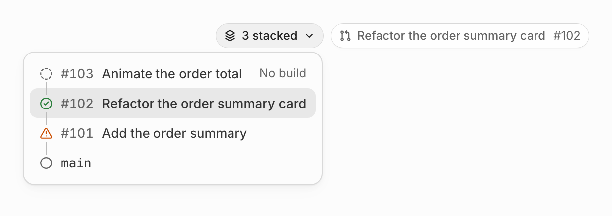

# Stacked pull requests

Argos supports stacked pull requests natively. When you open a pull request on top of another one, Argos compares its screenshots with the pull request below it instead of your baseline branch. Each build shows only the changes its own pull request makes, and the build page lets you move from one pull request of the stack to the next.

There is nothing to configure. Stack your pull requests by hand or with a tool like Graphite: what matters is that each pull request targets the branch of the one below it.


Stacked pull requests are detected on GitHub. Comparing with the pull request below relies on [baseline selection from commit history](../platform-fundamentals/baseline-build.md), which needs the [Argos GitHub App with full access](../integrations/github-integration.md#choose-your-access-level).


### How Argos detects a stack

A pull request is **stacked** when both are true:

* Its base branch is the head branch of another open pull request in the same repository.
* Its base branch is not an [auto-approved branch](../platform-fundamentals/baseline-build.md#auto-approved-branches).

A pull request opened from a fork never counts as the one below: a fork's branch can share its name with one of your repository's branches.

### What a stacked pull request is compared with

Take two pull requests:

1. **#101 Add the order summary**, from `feat/summary` into `main`.
2. **#102 Refactor the order summary card**, from `feat/summary-card` into `feat/summary`.

#102 is stacked on #101. Its [baseline branch](../platform-fundamentals/baseline-build.md#the-baseline-branch) is `feat/summary`, so Argos compares it with the build of #101 on the commit `feat/summary-card` starts from. If the refactor changes nothing visible, the build of #102 reports no changes. Compared with `main`, it would show every change of #101 again.

A build is usually a baseline only once it's [approved](../platform-fundamentals/baseline-build.md#when-the-baseline-must-be-approved). For a stacked pull request, Argos uses the build of the pull request below even before anyone approves it: that pull request is still in review, and its build is the state yours starts from. A rejected build is never used.

Rebase your pull request on the one below to compare with its latest changes. Once the pull request below is merged and yours targets your baseline branch again, its next build compares with that branch as usual.

### Move through the stack

On the build page of a stacked pull request, a **stacked** button appears next to the pull request in the header, with the number of pull requests in the stack. It opens the stack, from its top down to the branch it merges into:

* Each pull request shows the status of its latest build with the same [build name](../how-to-guides/ci-pipelines/monorepos-setup.md), and opens that build.
* The pull request of the build you're looking at is highlighted.
* A pull request that has no build yet reads **No build**.

When two open pull requests target the same branch, the stack forks, and the menu stops below them. Each of them is still compared with the pull request it targets.
